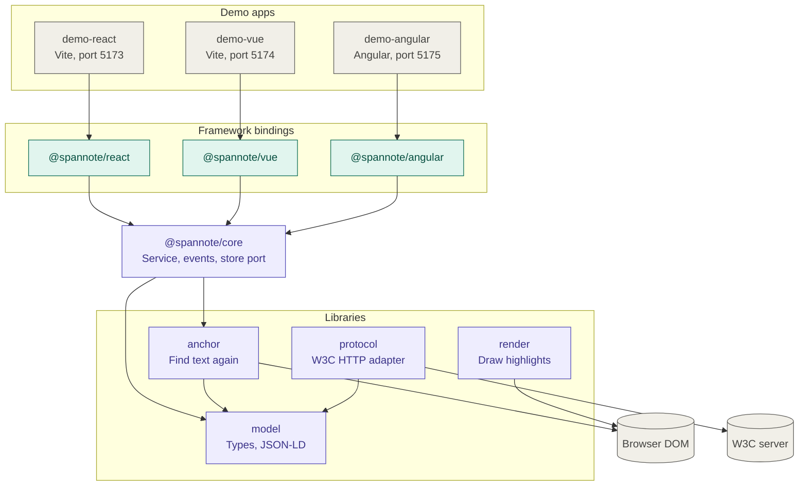

# SpanNote

[](https://github.com/manoj-mass/spannote/actions/workflows/ci.yml)
[](https://github.com/manoj-mass/spannote/actions/workflows/release.yml)
[](https://www.npmjs.com/package/@spannote/core)
[](LICENSE)

W3C-conformant annotations for the web: select text, comment, and keep the comment attached when the page changes.

SpanNote is a set of small, framework-agnostic packages. Use only what you need, from the data model up to React.

| Package                                   | Responsibility                                             | DOM            |
| ----------------------------------------- | ---------------------------------------------------------- | -------------- |
| [`@spannote/model`](packages/model)       | W3C data model: types, parsing of untrusted JSON, JSON-LD  | none           |
| [`@spannote/anchor`](packages/anchor)     | Describe a range as W3C selectors, and find it again       | reads          |
| [`@spannote/render`](packages/render)     | Draw highlights (CSS Custom Highlight API, mark fallback)  | CSS path: none |
| [`@spannote/protocol`](packages/protocol) | W3C Annotation Protocol client and storage adapter         | none           |
| [`@spannote/core`](packages/core)         | Annotation service: list, anchors, persistence, events     | none           |
| [`@spannote/react`](packages/react)       | Provider and hooks for React and Next.js                   | via core       |
| [`@spannote/vue`](packages/vue)           | Plugin, composables and root binder for Vue 3              | via core       |
| [`@spannote/angular`](packages/angular)   | Providers, signal functions and root binder for Angular 21 | via core       |

Documentation: [docs/README.md](docs/README.md).

## Architecture

Dependencies point downward. Framework bindings sit on the core service, and the core depends only on
the libraries it needs. The demo apps import the packages the same way an outside project does.



The layers, and the rules behind them, are described in [docs/ARCHITECTURE.md](docs/ARCHITECTURE.md).

## Quick start

```bash
npm install @spannote/core @spannote/react
```

```tsx
import { AnnotationService, MemoryAnnotationStore } from '@spannote/core';
import { SpanNoteProvider, useAnnotations } from '@spannote/react';

const service = new AnnotationService({ store: new MemoryAnnotationStore() });
void service.load();

export function Page({ children }: { children: React.ReactNode }) {
  return <SpanNoteProvider service={service}>{children}</SpanNoteProvider>;
}

export function CommentList() {
  const annotations = useAnnotations();
  return (
    <ul>
      {annotations.map((a) => (
        <li key={a.id}>{a.body[0]?.value}</li>
      ))}
    </ul>
  );
}
```

For a real backend, replace `MemoryAnnotationStore` with `ProtocolAnnotationStore` from `@spannote/protocol`.

## Design principles

SpanNote's behaviour comes from measurements, not assumptions. The Phase 0 spike ran on 53 live pages, in Chrome and Safari. The decisions below follow from those results. See [docs/ARCHITECTURE.md](docs/ARCHITECTURE.md) for the full rationale and the SOLID mapping.

1. **A position is accepted only when its text matches the quote.** Unchecked positions attached to the wrong text after page changes.
2. **Two text models, one per job.** Positions count code points over raw text (interoperable, as the spec requires). Quotes match over normalized text, so non-breaking spaces and reflow do not break them.
3. **Fuzzy matching is off by default.** It recovered small in-quote edits, but it also attached to wrong text in some cases.
4. **No DOM mutation by default.** Highlights use the CSS Custom Highlight API. Mark wrapping is a fallback, and it restores the original DOM on clear.
5. **Storage is a port.** The core never talks HTTP. The W3C protocol is one adapter; memory is another.

## Measured performance

From the Phase 0 spike (see the report in the spike notes):

- Resolves 500 annotations in about 0.6 to 2.5 ms in Chrome, once the index is built per page.
- A DOM index build takes 1 to 12 ms per page.
- Zero DOM mutations for CSS highlights (Chrome and Safari). Span wrapping, measured before the switch to `<mark>`, caused 26 to 90; the mark fallback is not yet measured.
- TextPosition agrees with other W3C implementations (Apache Annotator) on every check. `dom-anchor-text-position` counts UTF-16 code units and does not follow the spec on non-BMP characters.

## Known limitations

- Edits made inside a quote are not recovered by exact matching. Use fuzzy matching with care, or keep a text revision history in your content system.
- Items loaded from a protocol server have no version, so their updates and deletes are not conflict-checked. See [docs/guides/storage.md](docs/guides/storage.md#known-gap-protocol-list-versions).
- Highlights are not drawn by the service or the React binding. See [docs/guides/highlights.md](docs/guides/highlights.md).
- Only text targets. Image, video and PDF selectors are not implemented yet.

## Roadmap

- Revision-aware re-anchoring (edits mapped through text history).
- Image region and media time selectors.
- Offline outbox in `core`.
- Accessibility and CSP test suites.

## Development

```bash
npm install
npm run check        # typecheck, lint, format check, tests, build
npm run test:watch   # tests in watch mode
```

Node 20.19 or later. Tests run in jsdom; the packages import each other from source through path aliases, so no build is needed to test.

## Demo

A demo app shows the packages working together: comments on selected text, highlights, simulated page changes, and an optional local W3C server.

```bash
npm install
npm run build
npm run demo         # React demo: http://localhost:5173
npm run demo:vue     # Vue demo: http://localhost:5174
npm run demo:angular # Angular demo: http://localhost:5175
npm run demo:server  # optional: W3C server on port 4000
npm run demo:smoke   # automated check, with a demo and the server running
```

The demos use the built packages, the same output a user installs. See [docs/guides/demo.md](docs/guides/demo.md) for what to try and the URL settings.

See [CONTRIBUTING.md](CONTRIBUTING.md) for the workflow, [docs/NAMING.md](docs/NAMING.md) for naming standards, [docs/RELEASING.md](docs/RELEASING.md) for publishing, and [AGENTS.md](AGENTS.md) for guidance on working with AI agents.

## License

Apache-2.0. See [LICENSE](LICENSE).
